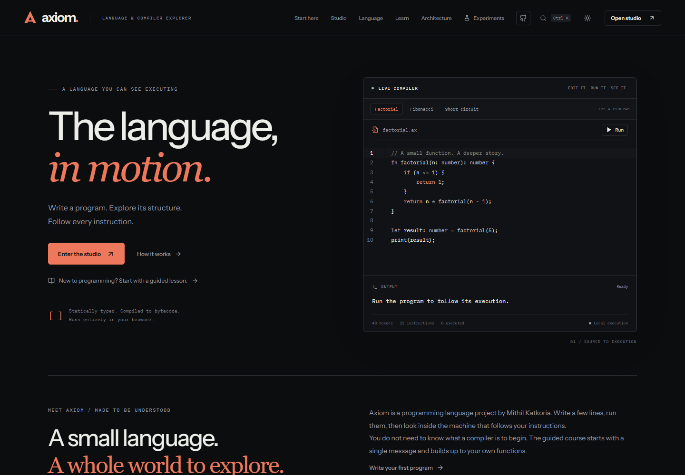
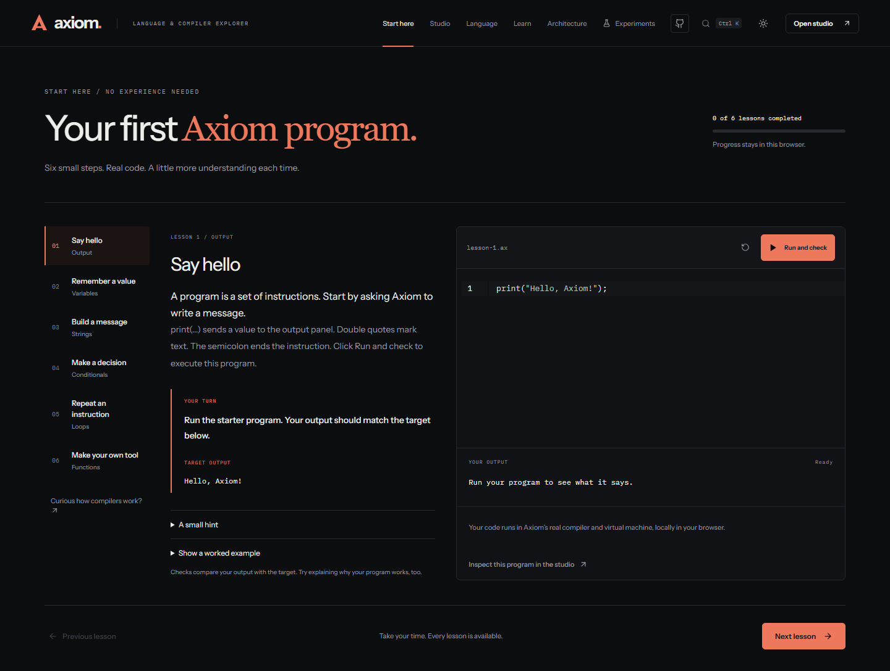
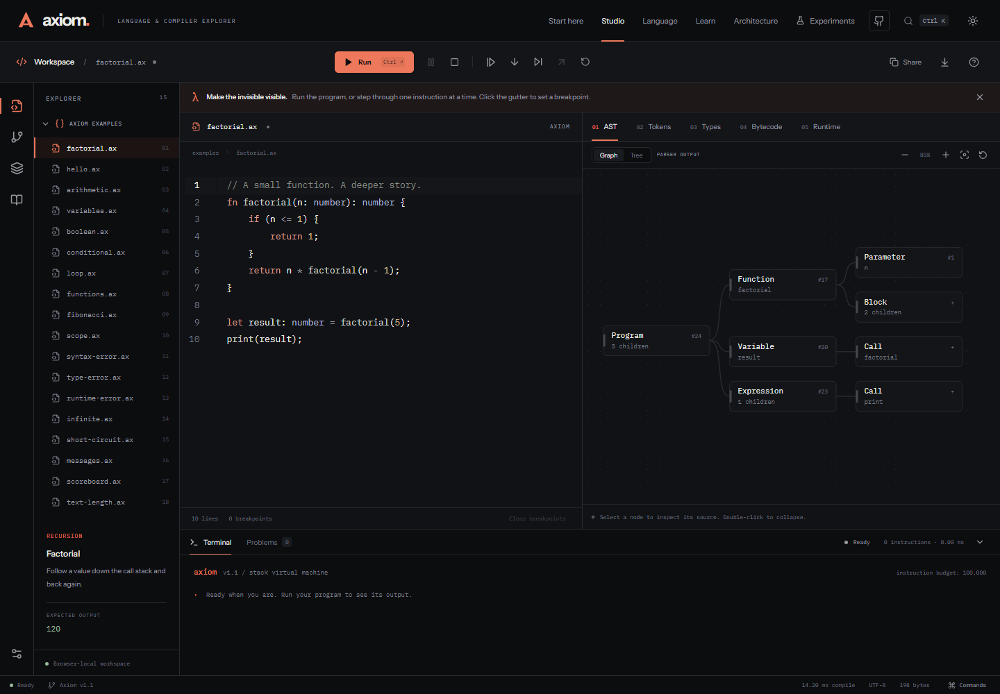

# Axiom

### A programming language you can see executing.

[](https://github.com/mithilkatkoria/axiom/actions/workflows/ci.yml)
[](LICENSE)

Write a program. Explore its structure. Follow every instruction.

Axiom is a statically typed programming language and an interactive compiler studio. Its compiler and virtual machine are written in **Rust**, compiled to **WebAssembly**, and connected to a **React/TypeScript UI**. Follow your source through tokens, syntax trees, type checking, bytecode, and a stack virtual machine. Set a breakpoint inside a recursive call and inspect the actual values that make it work.

**[Start learning](https://axiom-explorer.vercel.app/start)** · **[Open Axiom](https://axiom-explorer.vercel.app)** · [Explore the source](https://github.com/mithilkatkoria/axiom) · [Language guide](docs/LANGUAGE_SPEC.md) · [Architecture](docs/ARCHITECTURE.md) · [Verification record](docs/VERIFICATION.md)



## New to programming? Start here.

The [guided course](https://axiom-explorer.vercel.app/start) runs in your browser. No installation or previous programming experience is needed. Each lesson explains an idea, gives you a small challenge, runs your actual Axiom code and checks its output.

1. Print your first message.
2. Store and change a number.
3. Build text with + and str(...).
4. Make a decision with if.
5. Repeat work with while.
6. Write and call your own function.

Hints and worked examples are available throughout. Progress and edits stay in your browser. When you are ready, open the same program in the full studio to inspect its compilation and execution.



## A small language. The whole journey.

```text
fn factorial(n: number): number {
    if (n <= 1) { return 1; }
    return n * factorial(n - 1);
}
print(factorial(5)); // 120
```

The program above is lexed, parsed, checked, compiled to numeric bytecode, and executed in Axiom's VM. Source is never evaluated as JavaScript. Every inspector reads the current compiler result or execution snapshot.

| Explore      | What you can inspect                                                        |
| ------------ | --------------------------------------------------------------------------- |
| Source       | Axiom-aware editing, diagnostics, completion, search and source navigation  |
| Structure    | Exact tokens, an interactive syntax graph and a keyboard-accessible tree    |
| Meaning      | Scoped bindings, expression types and static errors                         |
| Instructions | Constant pools, source mappings, jumps and short-circuit control flow       |
| Execution    | Operand stack, recursive call frames, local values and program output       |
| Debugging    | Breakpoints, pause, continue, instruction stepping and source into/over/out |



## Run locally

Use **Node 24**. The lockfile is committed for reproducible installs.

```sh
git clone https://github.com/mithilkatkoria/axiom.git
cd axiom
npm ci
npm run dev
```

Open **http://127.0.0.1:5178**. Run the homepage example, or enter `/studio` for the debugger. Start with the eighteen included programs, then edit one to see how the compiler responds. Work is saved locally in your browser. Share links carry source in a URL fragment and never run it automatically.

## Under the surface

```text
source → lexer → parser → typed AST → semantic analysis → bytecode
                                                            ↓
                                     execution worker → stack VM
                                                            ↓
                                editor + inspectors + debugger
```

The compiler and VM live in `engine/src/` and have no React or DOM dependency. `src/language/` contains typed UI adapters and display contracts. Browser workers own compilation and execution, apply resource limits, and return versioned snapshots so edits cannot display obsolete results. The React interface turns that data into an explorable workspace.

```text
engine/src/       Rust lexer, parser, semantic analysis, bytecode compiler, VM
engine/pkg/       Checked WebAssembly artifact and integrity manifest
src/language/     Typed UI contracts and WebAssembly adapters
src/workers/      Execution and benchmark worker protocols
src/studio/       Editor, inspectors, syntax graph and debugger views
src/content.ts    Shared documentation content
src/App.tsx       Routes and workspace coordination
tests/            Language, documentation, migration, benchmark and browser checks
tests/reference/  Original engine, used only for compatibility tests
docs/             Specifications, design decisions and verification evidence
```

The interface includes dark and light themes, resizable panels, keyboard commands, responsive layouts, self-hosted Instrument Sans and IBM Plex Mono, and readable documentation even with JavaScript disabled.

The committed Wasm module makes the quick start Node-only. To change the compiler or VM, see [the Rust engine guide](engine/README.md) and [migration notes](docs/MIGRATION.md). The original engine remains as a compatibility test reference.

## Check the work

```sh
rustup target add wasm32-unknown-unknown
npx playwright install chromium
npm run verify
```

The complete check needs Rust 1.98.1 with rustfmt, Clippy and the `wasm32-unknown-unknown` target. It checks the committed artifact, runs native Rust tests and strict Rust lint, rebuilds Wasm, then runs strict TypeScript, ESLint, compiler and compatibility regressions, executable documentation, a production build and Chromium tests against a fresh preview server. Port 5178 must be free. On Linux CI, install browser dependencies with `npx playwright install --with-deps chromium`.

| Command                | Purpose                                               |
| ---------------------- | ----------------------------------------------------- |
| `npm run engine:build` | Rebuild the Rust compiler and VM as WebAssembly       |
| `npm run engine:test`  | Run native Rust regressions                           |
| `npm test`             | Compiler, VM, documentation and benchmark correctness |
| `npm run test:e2e`     | Build and check real browser interactions             |
| `npm run benchmark`    | Validate outputs and measure seven compiler/VM inputs |
| `npm run build`        | Emit the production app and prerendered documentation |
| `npm run preview`      | Serve the production build locally                    |

Actual results, browser coverage, screenshots and remaining gaps are recorded in [the verification record](docs/VERIFICATION.md). Benchmark results are environment-specific. The experiments page runs two warm-ups and ten measured samples per input and exports the measured data with environment metadata.

## Deploy

Production: **https://axiom-explorer.vercel.app**. The Vercel project is connected to this repository. Pushes to `main` run the full GitHub verification pipeline, then trigger a production deployment through a securely stored Vercel Deploy Hook. Pull requests run verification.

This repository is configured for Vercel: framework **Vite**, build command **`npm run build`**, output **`dist`**, root directory **`.`**. `vercel.json` includes clean documentation URLs and deep links for the studio and experiments.

Vercel uses the checked-in Wasm artifact and does not need a Rust installation. GitHub Actions rebuilds and tests Rust before deployment.

The Vercel project sets `VITE_SITE_URL=https://axiom-explorer.vercel.app` for canonical URLs, social metadata and the sitemap. Without an override, the prerenderer uses Vercel's production hostname. Set `VITE_SITE_URL=https://your-domain.example` to use a custom domain. No server, database or API key is required for the studio.

## Open source and project ownership

Axiom is a programming language project by **Mithil Katkoria**. Axiom is the language users write; Rust implements the compiler and VM, and React/TypeScript implements the studio. Coding-agent assistance and verification history are documented in the development log.

This repository is **public** and **MIT licensed**. You can study, fork, modify and share it under the license terms. Contributions are welcome, including beginner explanations, reproducible bug reports and carefully tested language improvements. The private flag in package.json prevents accidental npm publication; it does not make this GitHub repository private.

See [CHANGELOG.md](CHANGELOG.md) for language 1.1 and [CONTRIBUTING.md](CONTRIBUTING.md) to get involved.

## Learn more

- [Language specification](docs/LANGUAGE_SPEC.md) and [learning guide](docs/LEARNING_GUIDE.md)
- [Rust engine](engine/README.md) and [migration guarantees](docs/MIGRATION.md)
- [Architecture](docs/ARCHITECTURE.md), [bytecode reference](docs/BYTECODE.md) and [design decisions](docs/DESIGN_DECISIONS.md)
- [Experiments](docs/EXPERIMENTS.md), [testing](docs/TESTING.md) and [verification](docs/VERIFICATION.md)
- [Development log](docs/DEVELOPMENT_LOG.md) and [interview preparation](docs/INTERVIEW_PREPARATION.md)
- [Contributing](CONTRIBUTING.md) and [third-party notices](THIRD_PARTY_NOTICES.md)

## Deliberate boundaries

Axiom supports primitive values, mutable typed variables, lexical scopes, conditionals, loops and named recursive functions. It does not yet support arrays, objects, closures, first-class functions, imports or asynchronous programs. Numbers use finite IEEE 754 doubles. String concatenation requires two strings; str(value) makes number and boolean conversions explicit. len(text) counts Unicode scalar values. Return analysis is conservative.

Debugging is line-based and has no reverse execution. The graph shows at most 300 visible nodes, with the full AST available in the text tree. Resource limits bound browser work, but are not a formal safety proof. Chromium is the validated browser; broader browser and assistive technology audits remain future work.

Created by [Mithil Katkoria](https://github.com/mithilkatkoria), with coding-agent assistance documented in the development log. Contributions should preserve the link between what the interface shows and what the compiler actually does.

[MIT licensed](LICENSE). Bundled fonts retain their SIL Open Font License notices.
