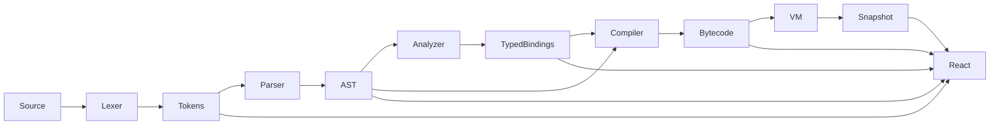

# Architecture

## Boundaries and data flow



`src/language/` imports no UI code. Its public entry is `index.ts`. `build(source)` returns a Compilation with a unique process-local ID, source, tokens, optional AST/semantics/program, diagnostics and per-stage durations. Failure stops the pipeline but retains valid earlier-stage data.

## Syntax

`model.ts` uses discriminated unions for expressions and statements. Node IDs increase within one parse. Spans contain UTF-16 start/end offsets plus one-based line/column. `children(node)` centralizes tree traversal without interpreting the program.

`lexer.ts` scans left to right. Comments do not produce tokens. Strings retain a source lexeme and a separately decoded primitive literal. `parser.ts` has individual routines for blocks, statements, primary expressions and precedence-climbing binary expressions. Recovery skips to a semicolon or next statement keyword. Parsing and AST-depth limits guard recursive passes.

## Semantic analysis

`semantic.ts` first registers top-level signatures in a null-prototype dictionary. A scope is a map from names to Bindings. Lookup walks the scope stack backward. Binding IDs, slots, lexical scope IDs, owner names and source spans are retained for compilation and inspection. Declaration initializers are checked before the new name is inserted. Variables in the main context use global slots; functions allocate fresh local slots. Every declaration has its own slot, so inner shadowing cannot overwrite an outer value.

Expression types are keyed by node ID. References map declaration/use nodes to binding IDs. The compiler consumes this resolution rather than resolving names a second time. A conservative structural pass checks non-void return paths. Function bodies are analyzed after the main statements, making top-level globals available to functions; the VM rejects reads before initialization.

## Bytecode

`bytecode.ts` lowers checked AST nodes into structured numeric opcodes, operands, source spans and node IDs. This is an executable instruction representation, not a packed binary file format. Primitive constants are interned by type and value. Instructions share a single address space, with main ending in HALT before function bodies. Function entries are recorded by name; CALL can therefore target later declarations.

Expression statements discard one result, including a void sentinel. PRINT consumes one value and produces void. A conditional pops its condition. Loop back edges use JUMP. Short circuit uses DUP and conditional jumps to keep exactly one boolean result. Jump patching fills targets once branch bodies have been emitted. See BYTECODE.md for stack effects.

## Runtime

`vm.ts` owns VM state. Tagged Values are primitive-only. A frame contains function name, return PC, stack base and local slots. CALL pops arguments into a new frame. RETURN removes the callee, restores the caller stack height, sets the saved PC and pushes one result. The operand stack preserves unfinished caller expressions below the callee stack base, enabling ordinary recursion.

executeStep mutates exactly one machine. executeProgram repeatedly steps it synchronously, intended for tests and the benchmark worker. The browser studio never executes user programs through this API on the main thread. snapshot copies observable state so the UI cannot mutate the live machine. Trace storage is bounded to 160 events.

## Worker and debugger protocol

`execution.worker.ts` owns the browser VM. Requests carry a monotonically increasing client version. compile creates a new compilation and VM; run starts cooperative chunks of at most 1,500 instructions; pause cancels the scheduled generation and reports paused state; reset replaces the VM using its compiled program; step supplies an instruction/source mode. Stop is implemented by terminating the worker in `studio/hooks.ts`, which also invalidates the version. A stopped session must reset to construct a worker again.

Each source edit immediately invalidates the hook session, terminates its worker and clears old compiler/runtime data. A 180 ms debounce creates the replacement. Outdated responses cannot commit state. Cleanup terminates workers on component unmount.

Source stepping compares current source line and frame depth with an anchor. Into stops at a new line or depth. Over ignores deeper frames until it returns to the original depth or shallower and reaches a new location. Out stops when the depth decreases. This is deliberately line-based: it is not arbitrary statement stepping or reverse execution. Source mappings can associate several instructions with one expression or statement.

## Views

`Editor.tsx` owns CodeMirror. The source string is persisted separately from editor internals. Effects update execution decorations and breakpoint gutters; diagnostics use CodeMirror's lint API. A custom StreamLanguage describes Axiom tokens without treating it as JavaScript.

`AstExplorer.tsx` memoizes tree layout. The graph supports pointer panning, zoom, fit, source selection and collapse; graph size is bounded. The expandable HTML tree is keyboard accessible and renders children on expansion. `Inspector.tsx` formats tokens, semantic bindings, expression types, bytecode pages and snapshots. No view invents compiler output. Clicking source-mapped data dispatches a selection to CodeMirror.

`App.tsx` coordinates the small URL router, controls, local preferences and public pages. `content.ts` is also consumed by `scripts/prerender.mjs`, which writes indexable HTML for /language, /learn and /architecture. Vite serves the SPA during development; the static build includes route directories. Canonical origins are deployment inputs, never an invented domain.

## Resource model

See LANGUAGE_SPEC.md for concrete limits. A worker is a browser responsiveness boundary, not an operating-system sandbox. Axiom's own instruction set exposes no host functions, imports, network or DOM. Safety checks bound instructions, calls, operands and output; source and syntax limits bound the frontend. Slots are retained, and snapshots have real copying costs. These are explicit implementation trade-offs, not a proof of resource optimality.

## Public engine API

```typescript
import {
  tokenize,
  parse,
  analyze,
  compile,
  build,
  createVM,
  executeStep,
  executeProgram,
  debugStep,
  snapshot,
} from "./src/language";
const compilation = build("print(2 + 3);");
if (compilation.program) {
  const vm = createVM(compilation.program, { instructionBudget: 10_000 });
  executeStep(vm);
  const observed = snapshot(vm);
}
```

`tokenize(source)` returns tokens and lexical diagnostics. `parse(tokens)` returns an AST and syntax diagnostics. `analyze(ast)` returns bindings, references, expression types, signatures and diagnostics. Only call `compile(ast, info)` when analysis succeeded. `build(source)` is the recommended untrusted-source boundary: it applies all stages and limits and distinguishes internal failures. `createVM(program, options)` constructs state; `executeStep(vm)` mutates one instruction; `executeProgram(program, options)` runs synchronously to a terminal status; `debugStep(vm, mode)` executes an instruction or source step; `snapshot(vm)` returns an independent observable copy. In browser integrations, use a worker for compilation, complete execution and source steps that may run many instructions.
